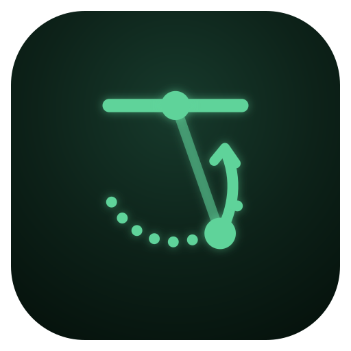

# Kip Lab

Bar gymnastics from one phone: film a set of kipping pull-ups, chest-to-bar, toes-to-bar or bar muscle-ups and get
the reps against the standard, the force through the bar, how much of each rep the kip gives, and whether the
hips lead the arms. On the phone, offline, nothing uploaded. An installable web app (PWA), built for a Galaxy S23
in Chrome, and Bar Path's sibling: same structure, much of the same code, meant to merge with it one day.

**Open it: <https://croway.github.io/kiplab/>** (once published), then *Install*.



| Movement | What you get |
|---|---|
| Pull-up (kipping or strict), chest-to-bar | reps; standard per rep: arms long at the bottom, chin over the bar / chest to it (✓, too close to call, ✗); from the kip; hips before arms; peak force through the bar; work per rep; energy kept between reps |
| Toes-to-bar | reps; toes to the bar; heels behind it before each rep; force; work per rep |
| Bar muscle-up | reps; arms long at the bottom; lockout above the bar; from the kip; hips and pull timing; force |
| Kip swing | swings, swing size, hollow and arch range at hips and shoulders, energy added per swing |
| All | camera angle (measured), whether the phone moved, frame rate; energy, force and body-shape charts; the path around the bar; CSV/JSON export; a gallery of sets |

## The physics

Hanging from a bar, only gravity and the bar act on the body, and the hands don't move, so the bar does no work:
every joule the body gains comes from its muscles, by changing shape at the right moment. From the body's centre
of mass (a 7-segment model, Winter's tables) every frame gives

- **force through the bar** F = m(a − g), in bodyweights (no mass needed);
- **energy** E = m g h + ½ m v² + the segments' own motion; its rise is what the muscles put in;
- **from the kip**: the share of the rep's energy already there when the arms start to pull;
- **work per rep**: the muscles' positive work over the rep, against lifting the body that high. Under 100% means
  the swing paid for some. The cheapest valid rep is the model the checks compare the others with;
- **hips before arms**: from the hip snap (the fastest the hip angle changes) to the moment the arms start to pull.

Each check says what it rests on: the movement's **standard**, **physics** measured on your reps, or a **coaching**
rule. There are no published norms for kipping kinematics (the research is mostly muscle activity), so physics
checks compare your reps with your own best rather than with a textbook number.

**Arms pulling** is read from the *reach*, the shoulders' distance from the bar, not the elbow angle: an overhand
pull bends the elbows out sideways, towards a side-on camera, where the angle can't be seen.

## Filming

The app's start screen has the guide (a top view of where to stand). In short:

- As side-on as the racks allow: within 30° is best, 30–60° is fine (reps, timing, force hold; swing and
  hollow/arch get rougher), avoid front or back. The camera angle is measured from the body's swing and corrected
  for, with perspective.
- About 4 m away, phone at chest height and level, leaning on something still; portrait, 1× zoom.
- The whole swing in frame; 60 fps (Record does it); hang still 2–3 s before the first kip.
- Choose just the set on the timeline: no jumping up or dropping off.

A phone that moves is followed (the bar's place and the scale frame by frame), and the Filming card says so.

## Run

```bash
npm install                 # playwright-core and jsqr, for tests and icons only
npm run vendor              # MediaPipe runtime + pose models into vendor/ (~62 MB, not committed)
npm run serve               # http://localhost:8766
tools/phone.sh [device]     # serve to the phone over adb as http://localhost:8766 and open it
npm test                    # the analysis against a simulated athlete + QR read-back
npm run shared              # how the shared files stand against Bar Path's (../barpath)
```

Tests:

- `test/kip.test.mjs`: the analysis against `test/sim.mjs`, a hanging body whose swing follows from the physics
  (prescribed shape, free swing, zero grip torque), filmed side-on to 60° with perspective and tracking noise:
  camera angle, centre of mass, energy, force, the gravity check, reps, kipping vs strict, hips-before-arms timing.
- `test/track.mjs <video> <out>`: MediaPipe over a real video in headless Chrome (the app's own modules) →
  landmarks + a contact sheet with the skeleton. `test/run.mjs <samples>`: the analysis on them, printed.
- `test/real.mjs <folder>`: real clips against what a person saw in them (local only: clips stay out of the repo).
- `test/e2e.mjs <video> <out>`: the whole app at S23 size in headless Chrome: choose the set by dragging the
  timeline, track, results, scrub, gallery, share QR.

## Shared with Bar Path

Same layout, conventions and much of the code; `tools/shared-check.sh` lists every shared file as identical,
adapted or extracted. See CLAUDE.md for the plan to merge.

MediaPipe is Apache-2.0 (its licence is saved in `vendor/mediapipe/LICENSE` by the fetch script).
